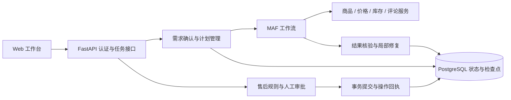
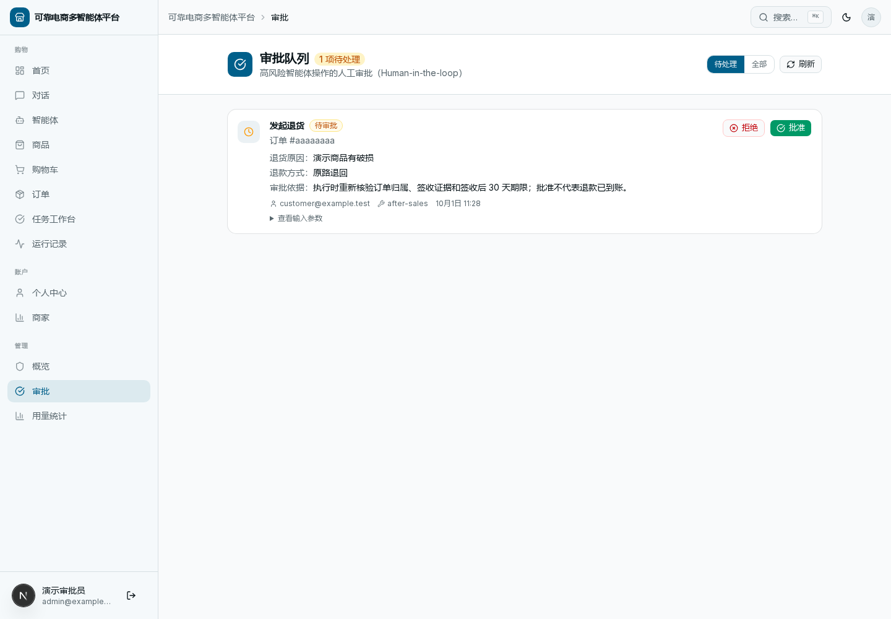
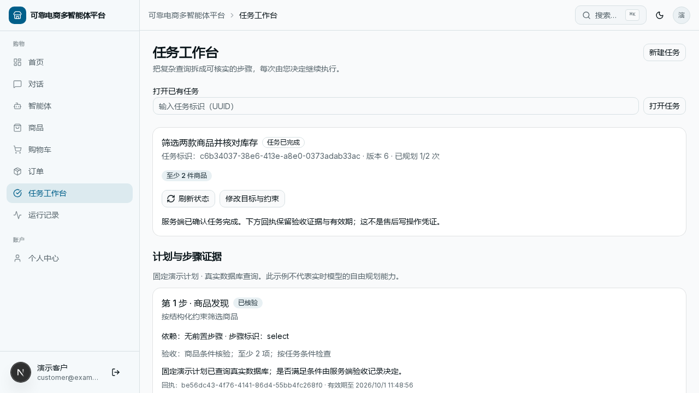

# Reliable Commerce Agents

**面向采购决策与售后处理的电商多智能体系统。**

项目将商品检索、价格、库存、评论与订单服务接入统一编排层，支持从需求确认、方案比较到售后审批的业务流程。实现重点是多智能体任务的可靠执行：将业务规则、审批、事务提交和结果查询放在服务端，使用持久化状态管理任务修订、并发调用与中断恢复。

后端基于 Microsoft Agent Framework、FastAPI 和 PostgreSQL，前端使用 Next.js、React 与 TypeScript。系统提供中文采购工作台、聊天、订单、审批队列和运行记录页面。

## 核心能力

- **采购方案生成**：将中文需求整理为结构化草案，由用户确认数量、货款预算和候选范围，再调用价格、库存和评论服务生成可比较的方案。
- **多智能体协作**：将冻结的计划编译为 MAF 分层工作流，支持受限并行、步骤回执复用和局部修复。需求版本、计划版本与执行代次共同隔离过期响应。
- **统一售后规则**：聊天工具、HTTP API 与工作流共用退货服务，根据用户身份、订单归属、签收信息及退货期限判断申请资格。
- **人工审批与事务执行**：审批绑定申请参数、政策版本和有效期，执行前重新校验；退货申请、订单状态和操作回执在同一 PostgreSQL 事务中提交。
- **中断恢复**：通过操作 ID、数据库行锁和唯一约束处理重复提交；连接中断后查询已保存的结果，任务重启后延续调用次数与费用预算。
- **可观测性**：运行事件、检查点、任务快照和 OpenTelemetry 调用链帮助定位执行问题。前端通过带序号的事件流更新进度并处理断线续接。

## 系统架构



模型负责理解需求和组织工具调用，业务服务负责权限、规则和数据写入。采购流程将执行状态与页面展示分开：服务端保存权威任务快照，前端依据版本和事件序号更新界面，避免晚到响应覆盖新需求。

## 重点实现

| 模块 | 实现内容 | 代码入口 |
|---|---|---|
| 采购运行时 | 分层任务图、并行调度、租约、调用预算、回执复用与局部修复 | [shared/procurement](agents/python/shared/procurement/) |
| 售后可靠执行 | 统一资格规则、审批绑定、幂等操作与提交后结果查询 | [shared/after_sales](agents/python/shared/after_sales/)、[hitl.py](agents/python/shared/hitl.py) |
| 任务与上下文 | 目标修订、结构化条件、任务验收与可恢复状态 | [task_state.py](agents/python/shared/task_state.py)、[context_pipeline.py](agents/python/shared/context_pipeline.py) |
| 采购交互 | 中文草案确认、预算修订、方案比较、SSE 断线续接与快照顺序控制 | [procurement.ts](web/src/lib/procurement.ts)、[采购页面](web/src/app/(app)/procurement/page.tsx) |
| 检索与观测 | 统一检索过滤、调用追踪、任务与接口评测工具 | [search.py](agents/python/shared/search.py)、[evals](agents/python/evals/) |

采购计划最多包含 8 个业务节点、同时执行 2 个专业调用；失败后最多进行一次自动局部修复。修订需求和恢复任务均沿用同一任务的累计调用与费用限制。采购结果用于比较商品与货款方案，不直接创建订单或消费优惠券。

## 界面展示





## 本地运行

准备 Docker Engine / Docker Compose 与 Python 3，在 Linux 或 Windows WSL 中执行：

```bash
git clone https://github.com/s1encisi/reliable-commerce-agents.git
cd reliable-commerce-agents
bash scripts/showcase.sh serve
```

保持终端运行，访问 **http://localhost:3020**。首次构建需要下载镜像与依赖。

| 角色 | 账号 | 演示密码 |
|---|---|---|
| 客户 | customer@example.test | DemoPass123! |
| 管理员 | admin@example.test | DemoPass123! |

演示使用合成订单、固定离线计划和实际 HTTP / 数据库服务，无需模型 API Key。可依次体验客户申请、管理员审批、结果查询，以及 `/tasks` 和 `/procurement` 的查询与采购流程。模型规划可通过 [.env.example](.env.example) 配置提供方后启用。

本地演示不连接真实支付、物流或邮件服务。容器管理见[运行指南](docs/local-showcase.md)，开发环境配置见[快速开始](docs/quick-start.md)。

## 技术栈

| 层次 | 技术 |
|---|---|
| 服务与智能体 | Python 3.12、Microsoft Agent Framework、FastAPI、asyncpg |
| 数据与缓存 | PostgreSQL、pgvector、Redis |
| Web 应用 | Next.js、React、TypeScript、Tailwind CSS |
| 部署与观测 | Docker Compose、OpenTelemetry |
| 测试 | pytest、前端单元测试、Playwright |

依赖版本分别由 `uv.lock` 和 `pnpm-lock.yaml` 管理。评测工具覆盖售后规则、采购方案、检索与故障恢复，可在合成业务场景中运行。

## 项目文档

[采购演示](docs/procurement-demo.md) · [采购架构](docs/procurement-architecture.md) · [售后架构](docs/after-sales-architecture.md) · [API 参考](docs/api-reference.md) · [配置说明](docs/configuration.md)

## 致谢与许可

项目基于 [nitin27may/e-commerce-agents](https://github.com/nitin27may/e-commerce-agents) 的电商平台基础，重点扩展售后可靠执行、采购运行时、任务恢复与中文工作台，采用 [MIT 许可证](LICENSE)。
