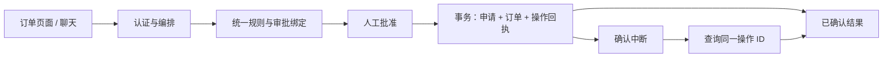

# Reliable Commerce Agents

**让电商 Agent 的采购决策有依据、售后操作可核实。** 项目基于开源电商多智能体平台，围绕退货申请实现统一业务规则、人工审批、持久操作回执和故障恢复，避免把模型回复或 HTTP 成功误当成业务已经完成。

平台通过 Microsoft Agent Framework、FastAPI 和 A2A 风格 HTTP 通信连接编排器与专业智能体；Next.js 前端提供聊天、订单、审批、任务工作台和运行记录页面。

## 核心能力

- **规则一致：** 普通工具、HTTP 请求与工作流调用同一退货服务，依据可信用户身份、订单归属和签收证据判定资格。
- **先审批再写入：** 审批绑定订单、参数、政策版本和有效期，执行前重新核对，不允许模型绕过审批。
- **可恢复的执行：** 按用户隔离操作 ID，使用 PostgreSQL 事务、行锁和唯一约束保存业务结果；相同请求可重放原回执。
- **明确处理未知结果：** 提交后连接中断时先查询实际结果，无法确认则保留“未知”，不盲目重复写入。
- **可观测与评估：** 检查点、运行事件和故障注入测试支撑恢复验证；可选模型路由提供费用预算和结构化决策约束，默认关闭。



关键实现位于 [`shared/after_sales`](agents/python/shared/after_sales/)、[`shared/hitl.py`](agents/python/shared/hitl.py) 和 [`return_replace.py`](agents/python/workflows/return_replace.py)。

## 演示

下图为本轮真实浏览器验证中的合成订单审批界面（历史截图继续保留）：


推荐使用已验证的独立容器展示。准备 Docker Engine/Compose 和 Python 3，在项目根目录执行：

```bash
bash scripts/showcase.sh serve
```

保持终端打开，访问 `http://localhost:3020`。客户账号 `customer@example.test`，管理员账号 `admin@example.test`，合成密码均为 `DemoPass123!`。依次体验客户申请、管理员审批、客户核实回执，再进入“任务工作台”运行固定离线查询。首次构建需要下载官方镜像与锁定依赖；无需模型账号。停止、数据保留与隔离边界见[容器展示指南](docs/local-showcase.md)。

开发模式仍可通过 `scripts/demo.sh` 启动宿主服务，使用 3010/8180 端口；准备步骤、缺少签收证据和超期订单演示见[开发演示指南](docs/portfolio-demo.md)。

真实模型对话需单独配置提供方并使用 `scripts/dev.sh`，离线工作流不会被当作实时模型推理。配置模板为 [.env.example](.env.example)。

## 采购决策与可靠协同执行

采购工作台位于 `/procurement`：中文需求先生成草案，由用户确认采购数量、货款预算和备选数量后自动执行。每个备选是一个 SKU × 数量；单券货款不含运税、不叠加优惠，系统不创建订单、不占用库存、不消费优惠券。

- MAF 将冻结的计划编译为分层工作流，最多 8 个业务节点、2 个并行专业调用；数据库保存步骤尝试、证据和事件。
- 价格、库存和评论通过实际专业服务取证。失败按对象和能力定位，最多一次自动局部修复；未受影响的有效回执可复用。
- 需求、计划和执行代次分别标识；旧响应不能更新新版本。暂停和重启继续沿用同一任务的累计调用与费用约束。
- 本机演示使用明确标注的规则解析、固定离线计划及真实 HTTP/数据库工具。模型规划和受限专业模型执行已有接线，但本轮没有调用付费模型，质量目标没有当成已测结果。

[中文连续演示](docs/procurement-demo.md) · [执行与恢复架构](docs/procurement-architecture.md) · [评测口径](docs/procurement-evaluation.md)

## 本轮增强：可核实的查询任务

- **任务工作台**：在 `/tasks` 创建只读目标和结构化条件，显式规划、执行、核实和恢复；自由文本目标需用户确认，不以任意工具成功判定完成。
- **可修订上下文**：聊天中可编辑目标和约束，保留替代、撤销和目标版本；历史偏好作为资料，不成为系统权限。
- **一致检索**：词法、向量融合及无嵌入降级使用相同价格、品类与评分过滤；评测保留无结果失败，不夸大离线向量的语义效果。
- **外部履约实验**：可选的本机模拟供应商与 outbox 演示幂等投递、丢响应核实和人工对账，默认关闭，不接真实物流或支付。

离线任务示例是明确标注的固定计划，工具实际查询数据库；它不代表实时模型规划。见[任务工作台](docs/task-workspace.md)、[检索评测](docs/retrieval-evaluation.md)和[履约模拟](docs/fulfillment-simulation.md)。

## 技术栈与工程取舍

Python 3.12、Microsoft Agent Framework、FastAPI、asyncpg、PostgreSQL/pgvector、Redis、OpenTelemetry；前端使用 Next.js、React、TypeScript 和 Tailwind CSS。Python 与前端分别由 `uv.lock` 和 `pnpm-lock.yaml` 固定依赖。

业务规则和执行结果由可信服务与数据库决定，LLM 负责理解和编排。操作回执解决同一数据库内的重试恢复；没有接入真实支付、物流或邮件，也不将本地事务描述为跨系统“恰好一次”。

## 验证

2026-10-14 采购升级：后端 **1159 passed / 3项真实模型测试跳过**，前端 **236 passed**。120条离线工程对照全部保留；新MAF与顺序适配器均26/30完成，关闭局部修复为10/30。新运行时减少了该任务集的工具查询，但本轮未取得端到端延迟优势。[采购结果与边界](docs/evaluation/procurement-20261014-r2.md)

2026-10-01 基线完整回归：后端 **1039 passed / 3 项真实模型测试跳过**，前端 **211 passed**；独立MCP包 **25 + 21 passed**。生产容器、真实浏览器、整栈重启保留数据和文档生成已验证。具体环境、警告及适用范围见[验证记录](docs/verification.md)。


2026-10-01 已重新运行全部 396 次售后隔离 trial：B0 为 36/66、B1 为 51/66、当前实现 B2 为 66/66。新报告绑定本次工作树源码散列；旧报告保留，不能用旧文件的散列代表新代码。并发基线存在实际运行差异，逐次结果均保留。

[当前售后结果](docs/evaluation/after-sales-20261001.json) · [基线来源审计](docs/evaluation/after-sales-baseline-audit-20261001.json) · [验证说明](docs/verification.md)


2026-09-30 本地运行售后规则、入口、恢复和兼容预算相关的 69 项既有测试，全部通过：

```bash
cd agents/python
uv sync --frozen --all-packages --extra dev
OPENAI_API_KEY= AZURE_OPENAI_KEY= AZURE_OPENAI_API_KEY= RECORD=false \
  uv run --no-sync pytest tests/test_after_sales_policy.py tests/test_after_sales_entries.py \
  tests/test_after_sales_recovery.py tests/test_legacy_jev_budget.py -q
```

仓库还提供 [售后故障评估器](agents/python/evals/after_sales.py)、固定对照和 [原始评估数据](docs/evaluation/after-sales-results.json)。这些是受控合成场景下的工程证据，不代表生产成功率。

## 进一步阅读

[售后架构](docs/after-sales-architecture.md) · [快速开始](docs/quick-start.md) · [配置](docs/configuration.md) · [API](docs/api-reference.md) · [模型路由与预算](docs/agent-upgrade.md) · [中文项目讲解](docs/portfolio-interview.md) · [容器体验部署](docs/local-showcase.md)

本项目基于 [nitin27may/e-commerce-agents](https://github.com/nitin27may/e-commerce-agents) 演进；上游提供平台基础，本仓库的售后可靠性与决策评估实现可在对应模块和测试中核对。采用 [MIT 许可证](LICENSE)。
