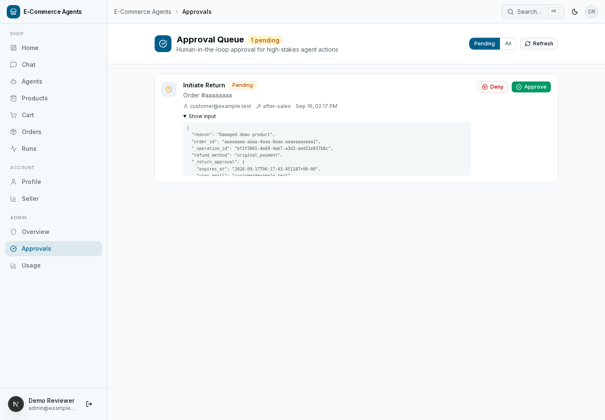
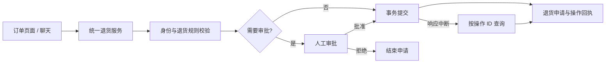

# Reliable Commerce Agents

面向电商业务的多智能体应用，支持商品查询、订单管理、促销咨询和售后处理。项目基于 Microsoft Agent Framework 与 FastAPI 构建，重点实现退货申请中的规则校验、人工审批、幂等执行和中断恢复。

[快速开始](#快速开始) · [架构设计](docs/after-sales-architecture.md) · [项目文档](docs/README.md)

## 功能与特点

- **多智能体协作**：编排器连接商品、订单、定价、评论和库存服务，支持工具路由、Handoff、工作流与群聊编排。
- **统一售后规则**：聊天工具、HTTP API 和工作流共用退货服务，按用户身份、订单归属、签收时间与退货期限判断资格。
- **人工审批**：按配置和订单金额触发审批；审批绑定申请参数、订单状态和有效期，执行前再次校验。
- **幂等执行与恢复**：通过操作 ID、PostgreSQL 事务、行锁和唯一约束防止重复申请。响应中断后可查询原操作，返回已保存的结果。
- **完整的操作界面**：Next.js 前端提供聊天、订单、审批队列与运行记录；OpenTelemetry 记录调用链路，便于排查问题。

## 界面预览

客户提交退货申请后，审批人可在队列中查看订单、申请原因和处理状态。



## 售后流程

LLM 负责理解请求和编排工具，业务服务负责校验与执行。退货申请、订单状态和操作回执在同一个数据库事务中提交。



签收信息缺失或冲突时转人工核实，超过退货期限则拒绝申请。提交结果暂时无法确认时保留操作 ID，后续继续查询。

核心实现：

| 模块 | 职责 |
| --- | --- |
| [售后服务](agents/python/shared/after_sales/) | 资格判定、审批绑定、事务执行与结果查询 |
| [审批管理](agents/python/shared/hitl.py) | 审批请求、决定与执行状态 |
| [退货工作流](agents/python/workflows/return_replace.py) | 流程编排、检查点与暂停恢复 |
| [编排器](agents/python/orchestrator/) | 请求路由、智能体协作与事件流 |
| [Web 界面](web/src/) | 客户操作、审批队列与运行记录 |

## 快速开始

本地演示使用合成订单和固定工作流，无需模型 API Key。准备 Python 3.12、uv、Node.js 22、pnpm 10 和 Docker，在 Linux、macOS 或 Windows WSL 中运行：

```bash
git clone https://github.com/s1encisi/reliable-commerce-agents.git
cd reliable-commerce-agents
bash scripts/install-deps.sh --core --images
bash scripts/demo.sh
```

打开 **http://localhost:3010**：

| 角色 | 邮箱 | 密码 |
| --- | --- | --- |
| 客户 | customer@example.test | DemoPass123! |
| 审批人 | admin@example.test | DemoPass123! |

用客户账户提交申请，再用审批人账户批准，回到订单页查看处理结果。详细步骤见 [演示指南](docs/portfolio-demo.md)。

接入真实模型对话时，按 [.env.example](.env.example) 配置模型提供方，并使用 `scripts/dev.sh` 启动；Windows PowerShell 使用 `scripts/dev.ps1`。配置说明见 [快速开始文档](docs/quick-start.md)。

## 技术栈

- **后端**：Python、Microsoft Agent Framework、FastAPI、asyncpg
- **数据与缓存**：PostgreSQL、pgvector、Redis
- **前端**：Next.js、React、TypeScript、Tailwind CSS
- **工程工具**：Docker Compose、OpenTelemetry、pytest、Playwright

当前售后流程处理退货申请及其数据库状态，未接入真实支付、物流和邮件服务。

## 文档

[售后架构](docs/after-sales-architecture.md) · [API 参考](docs/api-reference.md) · [配置说明](docs/configuration.md) · [部署指南](docs/deployment.md) · [中文文档](docs/zh-CN/README.md)

## 致谢与许可

基于 [nitin27may/e-commerce-agents](https://github.com/nitin27may/e-commerce-agents) 构建，采用 [MIT 许可证](LICENSE)。
