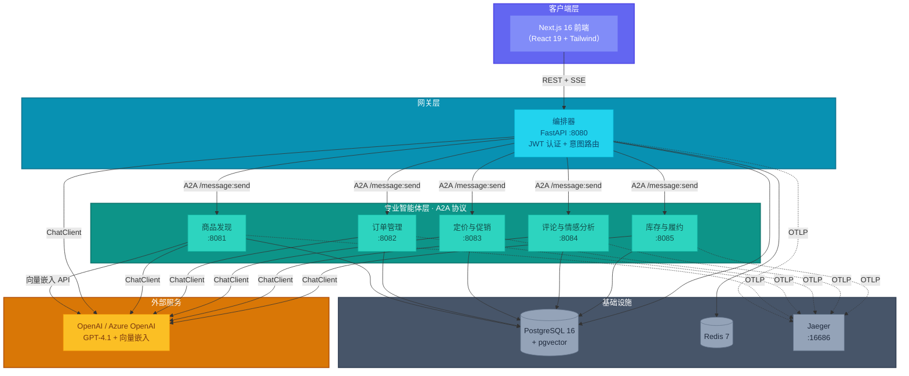
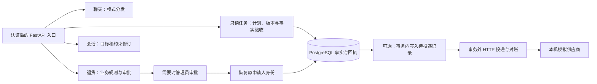
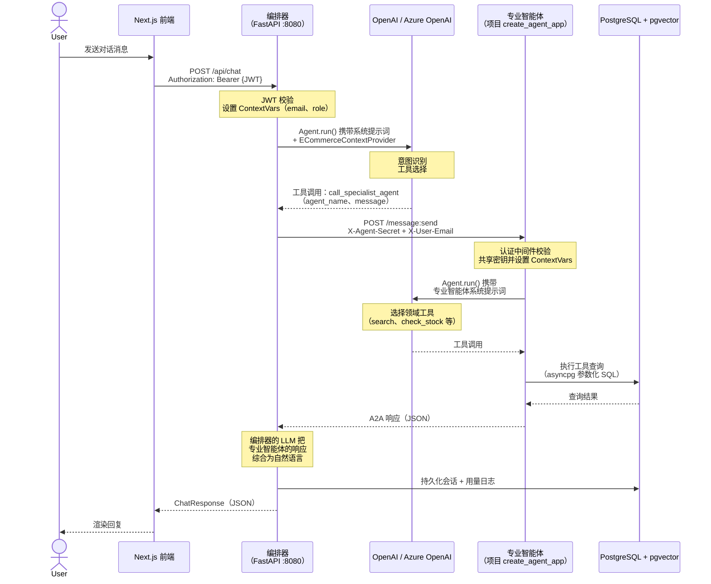
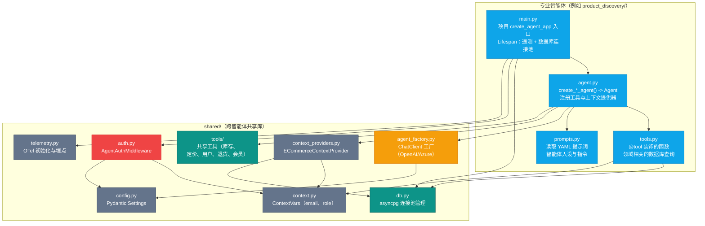
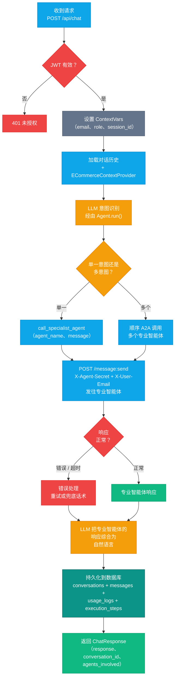
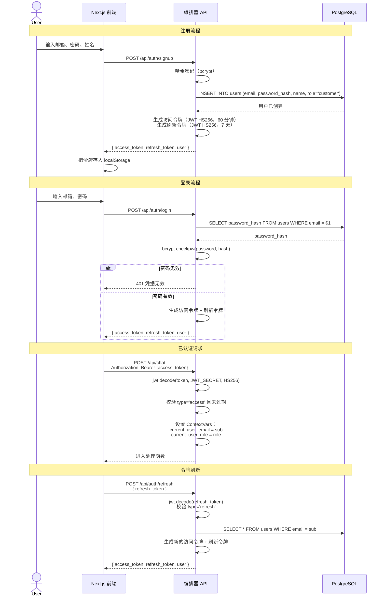
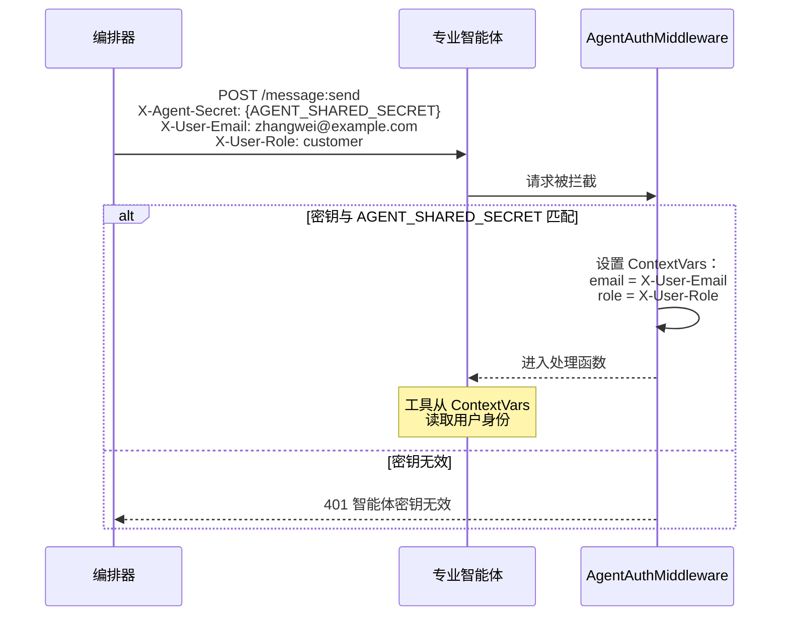
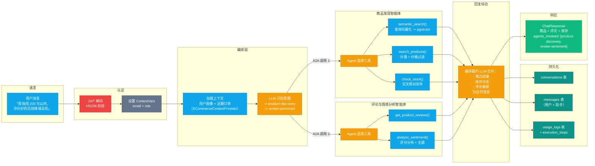

# 架构

平台基于 Microsoft Agent Framework，由一个编排器与五个专业智能体组成，共六个 Python 服务。专业智能体使用项目自定义的 A2A 风格 HTTP 契约通信；编排模式、只读任务、售后事务与会话上下文有各自明确的执行边界。

---

## 1. 系统总览

平台由三层构成：Next.js 前端、以 FastAPI 实现并背靠五个专业智能体的编排网关，以及共享基础设施（PostgreSQL + pgvector、Redis、Jaeger）。



本图展示通用开发端口与可选模型/遥测依赖。独立演示使用 3010/8180–8185，容器展示只发布本机 3020；详见[演示](portfolio-demo.md)与[容器方案](local-showcase.md)。

当前应用还有三条不应混为一次 LLM 路由的执行路径：



任务状态和文字目标确认见[任务工作台](task-workspace.md)；售后事务见[售后架构](after-sales-architecture.md)；履约模拟默认关闭，不接真实支付或物流。


---

## 2. 智能体通信模式

下图展示已登录用户在默认 tool 模式、配置真实模型时的一条请求链。固定工作流、只读任务和离线演示不必经过图中的每一次模型调用。浏览器通过 Next.js 同源代理访问编排器，公开购物能力允许匿名，个人业务继续验证身份。



---

## 3. 智能体架构

每个专业智能体遵循 main、agent、tools 与 prompts 的模块结构。HTTP 宿主由项目的 [shared/agent_host.py](../agents/python/shared/agent_host.py) 中的 create_agent_app 创建；MAF 负责模型与工具运行，不通过 agent-framework-a2a SDK 托管服务。prompts.py 读取 YAML 提示词配置。



### 智能体清单

| 智能体 | 端口 | 模块 | 关键工具 |
|-------|------|--------|-----------|
| **编排器** | 8080 | `orchestrator/` | `call_specialist_agent`（A2A 路由） |
| **商品发现** | 8081 | `product_discovery/` | `search_products`、`semantic_search`、`compare_products`、`find_similar_products`、`get_trending_products` |
| **订单管理** | 8082 | `order_management/` | `get_user_orders`、`get_order_details`、`get_order_tracking`、`cancel_order`、`modify_order`、`check_return_eligibility`、`initiate_return`、`process_refund` |
| **定价与促销** | 8083 | `pricing_promotions/` | `validate_coupon`、`optimize_cart`、`get_active_deals`、`check_bundle_eligibility`、`get_loyalty_tier`、`calculate_loyalty_discount` |
| **评论与情感分析** | 8084 | `review_sentiment/` | `get_product_reviews`、`analyze_sentiment`、`get_sentiment_by_topic`、`get_sentiment_trend`、`detect_fake_reviews`、`compare_product_reviews` |
| **库存与履约** | 8085 | `inventory_fulfillment/` | `check_stock`、`get_warehouse_availability`、`get_restock_schedule`、`estimate_shipping`、`compare_carriers`、`calculate_fulfillment_plan`、`place_backorder` |

---

## 4. 编排器模式

当前[模式注册表](../agents/python/orchestrator/modes/__init__.py)有六种模式，均由聊天接口按请求选择：

| 模式 | 作用与边界 |
| --- | --- |
| `tool` | 默认工具路由，模型选择专业工具调用 |
| `decision-router` | 可选结构化决策路由；策略默认 off |
| `handoff` | MAF 处理权交接网络 |
| `workflow:pre-purchase` | 售前固定图，包含并发检查与合并 |
| `workflow:return-replace` | 资格检查、需要时管理员审批、退货执行与收尾 |
| `group-chat` | 共享讨论记录的多角色圆桌 |

注册数量不等于每条路径都启用真实模型。固定离线流程可直接调用工具；不同模式完成的任务和调用范围不同，不能只按耗时排名。运行图可由 `GET /api/orchestration/modes/{name}/graph` 追踪到对应模式。

下图仅展开默认 tool 模式的模型路由，不是所有请求的唯一运行流程。退货工作流先检查资格，再在需要时等待管理员审批，之后才创建退货；只读任务的验收与恢复见任务工作台。



---

## 5. 认证流程

默认 AUTH_MODE=local 使用自包含 JWT（PyJWT + bcrypt），服务间使用共享密钥。另有 AUTH_MODE=oauth 的 OAuth/RS256 路径，用户令牌和服务间令牌按配置校验。以下时序图展示默认本地模式；两种模式都不能从模型生成的工具参数取得用户身份。

### 用户认证



### 智能体间认证



### RBAC 角色

| 角色 | 权限级别 | 说明 |
|------|-------------|-------------|
| `customer` | 默认 | 常规购物、订单、评论 |
| `power_user` | 扩展 | 通过应用市场使用高级智能体功能 |
| `seller` | 商家工具 | 起草评论回复、查看情感分析报告 |
| `admin` | 完全 | 审批访问申请、管理智能体目录、全部操作 |

完整的安全架构 —— 威胁模型、护栏中间件栈、身份伪造检测、SQL 归属过滤，以及生产环境加固清单 —— 见 [`docs/security-guide.md`](security-guide.md)。

---

## 6. 数据流

端到端数据流，展示一次用户请求如何穿越系统：从最初的 HTTP 请求，经由智能体处理，直到数据库持久化。



---

## 7. 技术选型

| 决策 | 选择 | 理由 |
|----------|--------|-----------|
| **智能体框架** | 微软智能体框架（Microsoft Agent Framework，MAF）Python SDK | Agent、工具循环、上下文提供器与工作流构建由 MAF 提供；HTTP 服务适配由本项目实现。 |
| **智能体间协议** | 自定义 A2A 风格 HTTP 契约 | shared/agent_host.py 暴露 /message:send 等接口；不是 agent-framework-a2a SDK 或完整标准兼容性承诺。 |
| **LLM 提供方** | OpenAI / Azure OpenAI（可配置） | 通过 MAF 统一到单一 `ChatClient` 接口，用 `LLM_PROVIDER` 环境变量切换。生产用 Azure（托管身份、RBAC）；本地开发用 OpenAI —— 或通过 `LLM_BASE_URL` 接入任何兼容 OpenAI 的端点（Ollama、LM Studio、vLLM、OpenRouter），实现完全本地、零成本的开发闭环。 |
| **数据库** | PostgreSQL 16 + pgvector | 用同一个数据库承载关系型数据与向量嵌入。语义商品检索使用 `text-embedding-3-small`（1536 维）。IVFFlat 索引用于快速余弦相似度检索。 |
| **Web 框架** | FastAPI（编排器）+ Starlette（专业智能体） | 编排器用 FastAPI，因为它需要 REST 端点（认证、对话、应用市场、管理）。专业智能体由 shared/agent_host.py 的 create_agent_app 适配 MAF Agent。 |
| **认证** | 自包含 JWT（HS256）+ bcrypt | 演示环境不依赖外部身份提供方。访问令牌（60 分钟）+ 刷新令牌（7 天）。智能体间认证通过共享密钥请求头。 |
| **用户上下文** | Python ContextVars | 按请求作用域的状态（email、role），由认证中间件设置，任何 `@tool` 函数都可读取。无需通过函数参数传递用户信息。 |
| **数据库访问** | asyncpg（原生 SQL） | 对查询拥有最大控制力，没有 ORM 开销。参数化的 `$1, $2` 语法可防止 SQL 注入。每个智能体一个连接池（5–20）。 |
| **遥测** | OpenTelemetry -> Jaeger | 自动埋点：httpx（LLM + A2A 调用）、asyncpg（数据库查询）、FastAPI/Starlette（HTTP）。A2A 调用与工具执行有自定义跨度。全部通过 trace_id 关联。 |
| **缓存** | Redis 7 | 聊天滑动窗口限流；会话历史和持久业务状态保存在 PostgreSQL。 |
| **前端** | Next.js 16 + React 19 + Tailwind + shadcn/ui | 默认使用服务端组件，用 `pnpm` 管理依赖。客户端 JS 尽可能少。 |
| **容器化** | Docker Compose + 多目标 Dockerfile | 全部 6 个智能体共用一份 Dockerfile，通过 `ARG AGENT_NAME` 区分。每个智能体是独立服务，各自占用端口。scripts/dev.sh 显式启用 agents/frontend 等 profile；隔离容器展示由 scripts/showcase.sh 启动。 |
| **包管理** | `uv`（Python）+ `pnpm`（Node） | `uv` 提供快速的依赖解析与虚拟环境管理。`pnpm` 提供磁盘高效的 node_modules。 |

---

## 8. A2A 协议

专业服务之间使用本项目的 A2A 风格 HTTP 请求-响应契约。编排器通过 httpx 异步请求调用 `/message:send`；这里没有独立消息代理。售后可选 outbox 是另一条持久投递路径。

### 端点

```
POST http://{agent-host}:{port}/message:send
```

各专业服务调用 shared/agent_host.py 的 create_agent_app 注册端点。目标主机、端口与服务名来自 `AGENT_REGISTRY`；认证、身份和上下文信息由可信调用路径传播，Python ContextVar 不会自行跨 HTTP 传播。

### 请求格式

```json
{
  "message": {
    "parts": [
      { "type": "text", "text": "帮我找 200 元以内的无线降噪耳机" }
    ]
  },
  "history": [
    { "role": "user", "content": "你们有哪些耳机？" },
    { "role": "assistant", "content": "我们有以下几款……" }
  ]
}
```

编排器会在 `history` 中转发最近 10 轮对话（每轮截断到 500 字符）。这既能让专业智能体在追问时有足够上下文，又避免请求体无限制增长。

### 认证请求头

| 请求头 | 取值 | 用途 |
|--------|-------|---------|
| `X-Agent-Secret` | `AGENT_SHARED_SECRET` 环境变量 | 校验调用方是可信编排器；缺失或错误时返回 401 |
| `X-User-Email` | 例如 `zhangwei@example.com` | 传递用户身份，用于工具查询中的按用户数据范围限定 |
| `X-User-Role` | `customer`、`seller`、`admin` | 传递 RBAC 角色，用于 `@tool` 函数内部的权限检查 |

`shared/auth.py` 中的 `AgentAuthMiddleware` 校验密钥并设置 ContextVars（`current_user_email`、`current_user_role`），每个 `@tool` 函数都直接读取它们 —— 无需把用户身份穿过函数参数。

### 响应

专业智能体以 JSON 返回完整的智能体响应。编排器把它交给自己的 LLM，综合为最终的自然语言回复。

### 请求顺序与并发

HTTP 使用异步请求-响应方式。默认 tool 模式由工具调用链决定下一步；售前固定工作流有明确的并发扇出/扇入，不能把“顺序调用一个专业智能体”的示例推广成所有模式的执行规则。

会话目标和约束由服务端 revision 保护，专业智能体消费可信上下文，不能把模型生成的 A2A 文本当成人类新指令写回。完整接口及权限边界见[API参考](api-reference.md)，固定退货链路见[售后架构](after-sales-architecture.md)。

## 相关内容

- [`docs/agent-flows.md`](agent-flows.md) —— 五张多智能体协作时序图
- [`docs/security-guide.md`](security-guide.md) —— 威胁模型、护栏、完整认证加固清单
- [`docs/maf-best-practices.md`](maf-best-practices.md) —— MAF 的 @tool、中间件与编排模式
- [`docs/adding-an-agent.md`](adding-an-agent.md) —— 新增专业智能体的分步指南
- [项目 README](../README.md)
