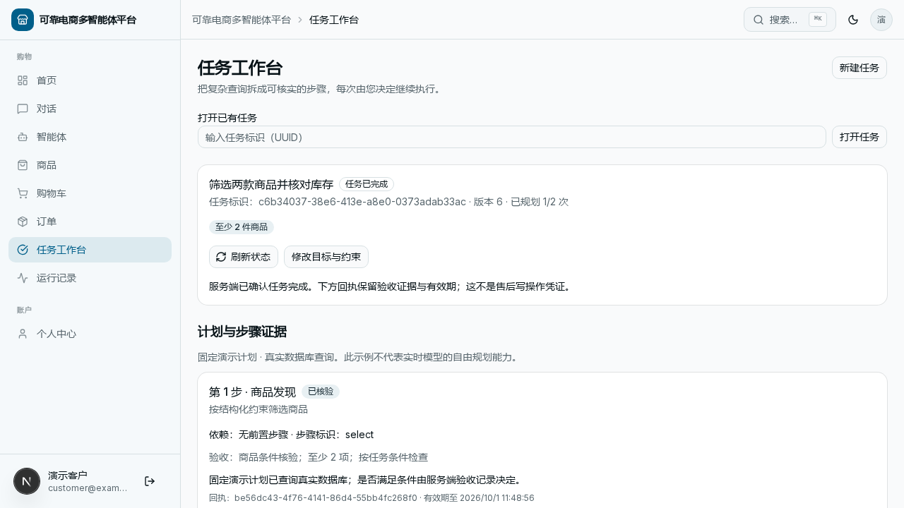

# 可靠电商 Agent：采购决策与售后可靠执行

项目以 Python、Microsoft Agent Framework、FastAPI、PostgreSQL 和 Next.js 构建电商助手，重点是把自然语言入口接到可审批、可核实的业务执行上。运行单元为**一个编排器与五个专业智能体**；退货能力位于订单领域和共享售后服务，不是额外的第六个专业服务。

## 先运行一条完整路径

推荐使用独立容器演示。准备 Docker Engine / Compose 与 Python 3，在仓库根目录运行：

```bash
bash scripts/showcase.sh serve
```

保持终端打开，访问 **http://localhost:3020**。客户账号 `customer@example.test`，管理员账号 `admin@example.test`，合成演示密码均为 `DemoPass123!`。默认离线计划调用真实服务和数据库，不需要模型密钥。

从采购工作台体验需求确认、方案比较与预算修订；售后路径可体验客户申请、管理员审批和结果查询。详见[容器运行指南](local-showcase.md)和[采购演示](procurement-demo.md)。需要开发环境时另看[3010 本机演示](portfolio-demo.md)，两种环境使用不同数据卷。

## 当前可追踪的能力

| 能力 | 实现与证据入口 |
| --- | --- |
| 采购需求确认、分层执行、证据复用与局部修复 | [采购架构](procurement-architecture.md)、[采购评测](procurement-evaluation.md) |
| 客户发起、管理员审批、原申请人身份执行 | [售后架构](after-sales-architecture.md)、[API](api-reference.md) |
| 幂等操作与中断后核实实际结果 | [当前验证记录](verification.md) |
| 只读任务规划、事实验收、显式恢复与人工确认 | [任务工作台](task-workspace.md) |
| 目标和约束修订、版本冲突与来源记录 | [上下文 API](api-reference.md#任务与可修订上下文) |
| 一致过滤的词法、向量融合和降级检索 | [检索评测](retrieval-evaluation.md) |
| 本机供应商、outbox、幂等投递与对账 | [履约模拟](fulfillment-simulation.md) |



## 六种已注册编排模式

`tool`、`decision-router`、`handoff`、`workflow:pre-purchase`、`workflow:return-replace`、`group-chat` 由同一个[模式注册表](../agents/python/orchestrator/modes/__init__.py)暴露。决策路由策略默认 `off`；注册不代表每种路径都启用了真实模型，也不代表它们完成相同任务、可以直接按耗时排名。

专业智能体通信使用项目自定义的 A2A 风格 HTTP 契约，入口由 `shared/agent_host.py` 实现，没有使用 `agent-framework-a2a` SDK。固定离线任务与退货工作流执行真实工具和数据库操作，但不能当作模型自由规划或泛化效果的证据。

## 阅读顺序与能力边界

先看[项目首页](../README.md)、[售后架构](after-sales-architecture.md)、[验证记录](verification.md)和[演示指南](portfolio-demo.md)，再按需进入[平台架构](architecture.md)、[概念](concepts/README.md)与[教程](../tutorials/README.md)。

当前和历史报告分别保留。检索数据及相关性标签由助手编写，尚待人工审核；离线哈希嵌入不是语义模型。真实模型质量、付费调用、公网体验部署和真实物流／支付不由本地回归代替。具体已执行结果、源码散列和限制以[验证说明](verification.md)及各报告为准，不从旧教程或旧计划推断当前能力。

完整阅读顺序、贡献规范与本地隐私边界见[项目导览](README.md)。

## 采购决策主线

[运行与连续演示](procurement-demo.md) · [执行与恢复架构](procurement-architecture.md) · [评测方法与边界](procurement-evaluation.md)
