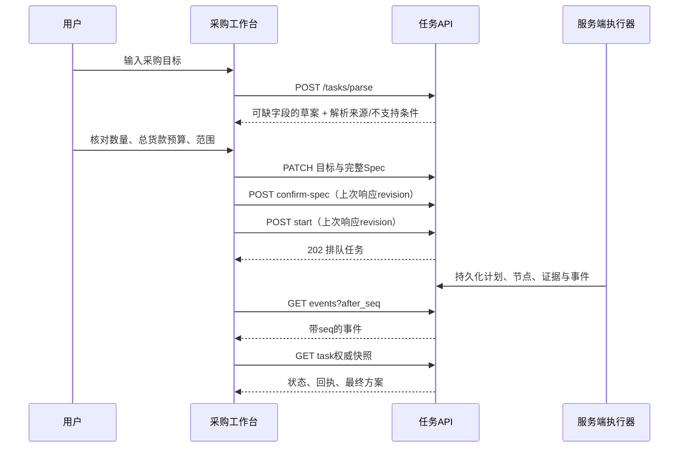

# 采购决策前端与运行时契约

采购任务是受限的只读采购决策流程：先确认结构化需求，再规划、执行、核验和有界修复。它与旧 `/tasks` 查询任务分开显示；新页面不循环点击旧任务的“下一步”。

## 控制面与显示面

`revision` 只控制用户变更的并发检查，后台进展由 `state_seq` 表达。页面按照 `(revision, state_seq)` 接受快照，并以任务和请求代次隔离晚到结果。事件用于触发合并后的只读快照请求，不将步骤状态误当整任务终态。

SSE 解析分块和 CRLF 帧，丢弃重复或非本任务序号，重连携带 `after_seq` 与 `Last-Event-ID`。草案流会结束，因此从草案进入执行时重新打开连接。服务端在最终事件被读取前结束流的竞态，通过终止后再读一次快照收束。HTTP 409 会重读状态并提示人工核对，不自动重放控制请求。

## 需求与边界

已确认的 Spec 包含检索词、1–100 的数量、1–2 个独立备选、十进制字符串总预算、CNY、现货、可选最低评分、偏好、`goods` 预算范围和 `single_coupon_v1` 优惠政策。前端只提交允许的字段，不把 `_parse` 元数据混进 Spec；缺失数量或预算时不能确认。

暂停后修改条件会将中文目标和 Spec 一起保存，防止旧目标中的金额与新预算相矛盾。不能支持的硬条件禁止确认，必须修改原需求重新解析。偏好只保留供原文核对，不声称已自动证明主观体验。

## 页面映射

| 文件 | 职责 |
| --- | --- |
| `web/src/lib/procurement.ts` | 类型、控制请求、金额规范化、快照顺序、计划分层、SSE续接 |
| `web/src/app/(app)/procurement/page.tsx` | 草案核对、暂停修改、运行状态、方案与历史证据 |
| `web/src/lib/nav.ts` | 独立采购入口，保留旧查询工作台 |
| `web/src/lib/procurement.test.ts` | 金额边界、版本/序号、分块SSE与认证续接 |
| `web/src/app/(app)/procurement/page.test.tsx` | 人工确认、顺序CAS、409、暂停预算、晚到响应与证据显示 |
| `web/e2e/procurement-live.spec.ts` | 合成账户下真实离线API与数据库端到端验收 |

页面最终方案按每个 SKU 独立展示数量、报价拆分、库存数、评论原文与风险引用。旧计划证据保留并标记历史计划，过期回执显式标记，原始机器协议放在诊断中。

## 后端运行时验收边界

后端由 `shared/procurement/` 的契约、计划、状态、调度、领域查询与核验模块，以及采购控制路由协作。其具体自动执行器、跨服务认证、租约、局部重规划和复用安全的最终说明，应以本次后端专项与真实多服务集成证据为准；前端合同测试不代替这些后端专项证明。2026-10-14 的真实 host 浏览器验收已验证同一采购任务完成后修订预算、产生替代方案和可回看的局部修复记录；详见演示文档中的任务标识与结果。生产镜像与执行中断隔离仍应分别绑定其实际验收证据。

参见[采购演示](procurement-demo.md)。

## 模型边界的本地验证

专业模型只有当前节点绑定的无参只读工具。成功取得证据后通过MAF的MiddlewareTermination终止工具循环，避免再次调用模型复述结果；已知DomainError也按原错误码和SKU返回修复器。无工具调用的JSON回答不能充当证据，重复并行调用同一工具只读取一次绑定回执。

这些路径使用真实MAF和预设客户端响应验证，没有访问付费模型。每个真实HTTP尝试仍经过任务级24次上限和既有费用预留，两者不会因需求修订重置。
